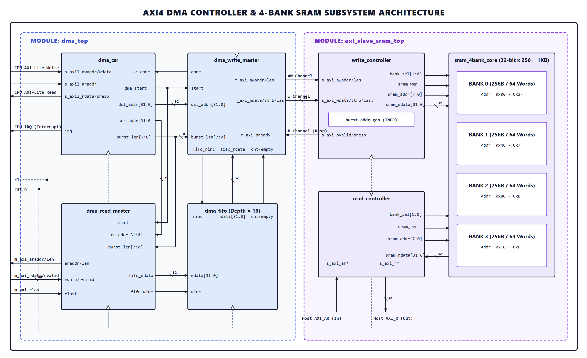
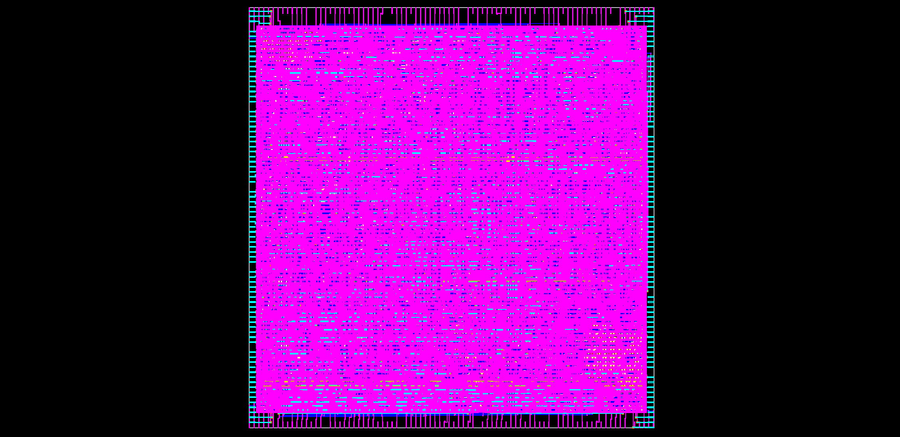

# AXI4 / AXI-Lite DMA Controller & 4-Bank SRAM Subsystem

A synthesizable, high-performance Direct Memory Access (DMA) Controller IP integrated with an AXI4-Slave 4-Bank SRAM Subsystem (1 KB total capacity). Implemented from SystemVerilog RTL to GDSII on the **SkyWater 130nm PDK** using **OpenLane**.

---

## 🏛 Architecture

The design features an independent DMA Controller IP (`dma_top`) connected to an interleaved 4-Bank SRAM Subsystem (`axi_slave_sram_top`).



### Key Features
- **Bus Interfaces:** AXI4-Lite Slave for CSR configuration; dual independent AXI4 Read/Write Masters for concurrent transfers.
- **Store-and-Forward Buffer:** Synchronous FIFO (Depth: 16, 32-bit data) preventing bus deadlock; supports bursts from 1 beat up to 16 beats.
- **Interrupt Handling:** Hardware interrupt (`irq`) assertion upon transfer completion with Write-1-to-Clear (W1C) status clearing.
- **Memory Subsystem:** 4-Bank SRAM controller with continuous INCR burst address generation.

---

## 📐 PPA & Physical Implementation (Sky130)

The standalone `dma_top` IP is fully signed off through the OpenLane ASIC flow using the `sky130_fd_sc_hd` standard cell library.



| Metric | Result | Notes |
| :--- | :--- | :--- |
| **Technology** | SkyWater 130nm | Standard Cell Library: `sky130_fd_sc_hd` |
| **Frequency** | **166.67 MHz** ($T_{clk} = 6.0\text{ ns}$) | Critical Path: 3.99 ns, WNS: +0.54 ns (Timing Clean) |
| **Die Area** | **0.07815 mm²** | Core Area: ~68,706 µm² |
| **Core Utilization** | **51.89%** | 2,914 Standard Cells (565 Flip-Flops) |
| **Typical Power** | **~0.022 µW** | Internal: 0.014 µW, Switching: 0.008 µW |
| **Physical Sign-off** | **Clean** | 0 Magic DRC, 0 Routing DRC, 0 LVS, 0 Antenna violations |

---

## 🚀 Quick Start

### 1. Verification (ModelSim / QuestaSim)
```bash
# Run automated regression testbench (back-to-back bursts)
make sim

# Open simulation waveform in GUI
make gui
```

### 2. Physical Design Flow (OpenLane)
```bash
# 1. Setup design directory
mkdir -p ~/OpenLane/designs/dma_top/src
cp src/dma_*.sv ~/OpenLane/designs/dma_top/src/
cp config.json ~/OpenLane/designs/dma_top/

# 2. Run RTL-to-GDSII flow
cd ~/OpenLane
./flow.tcl -design dma_top -tag run_dma_v4_perfect

# 3. View final GDSII layout
klayout -s designs/dma_top/runs/run_dma_v4_perfect/results/final/gds/dma_top.gds &
```

---

## 📁 Repository Structure

```text
├── config.json              # OpenLane physical design configuration
├── Makefile                 # Simulation automation
├── pics/                    # Architectural diagram & GDSII layout assets
├── dma_structure.html       # Interactive DMA block visualizer
├── function.html            # Functional breakdown visualizer
├── logic_diagram.html       # Subsystem architecture visualizer
├── src/                     # Synthesizable SystemVerilog RTL modules
└── tb/                      # Self-checking SystemVerilog testbenches
```

---
